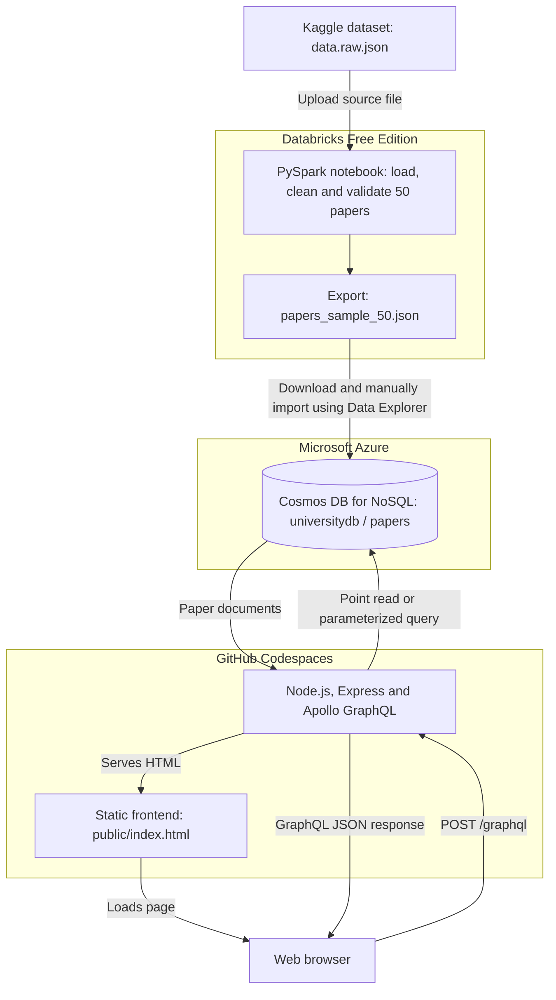

# University Research Papers — Architecture

The solution prepares 50 research papers in Databricks Free Edition,
imports them into Azure Cosmos DB, and displays them through a
custom GraphQL API and HTML frontend.

## Data preparation and transfer

1. Download the dataset from Kaggle and upload data.raw.json
   into a Databricks volume.
2. Load the source data using PySpark.
3. Select 50 papers, including paper ID 5073923.
4. Clean text and arrays, map venue to categories, and validate
   the prepared documents.
5. Export the documents as papers_sample_50.json.
6. Download the JSON file and import it through Cosmos DB
   Data Explorer into universitydb / papers.

The manual JSON transfer is the assessment's permitted fallback.
There is no direct Spark connector connection in this implementation.

## Storage

- Database: universitydb
- Container: papers
- Partition key: /id
- Throughput: manual, 400 RU/s
- Stored sample: 50 documents

## API and frontend

The Apollo GraphQL server uses the Azure Cosmos DB JavaScript SDK.

- paper(id): retrieves a document using its ID and partition key.
- papers(limit): lists up to 50 papers.
- papersByCategory(category, limit): matches values in the
  categories array across partitions.

Express serves the HTML frontend from the public folder.
The page calls /graphql on the same origin and displays the results.

Title search is case-insensitive filtering in the browser over
the retrieved 50-paper sample. ID and category searches use
their respective GraphQL operations.

## Credentials and hosting

The Cosmos DB endpoint and read-only key are loaded by the backend
from environment variables. The .env file is excluded from Git.
The frontend does not receive the Cosmos DB key.

The API and static frontend are served from GitHub Codespaces
for the demonstration. The forwarded port is kept private.
The application is available only while the Codespace and
Node.js server are running.
